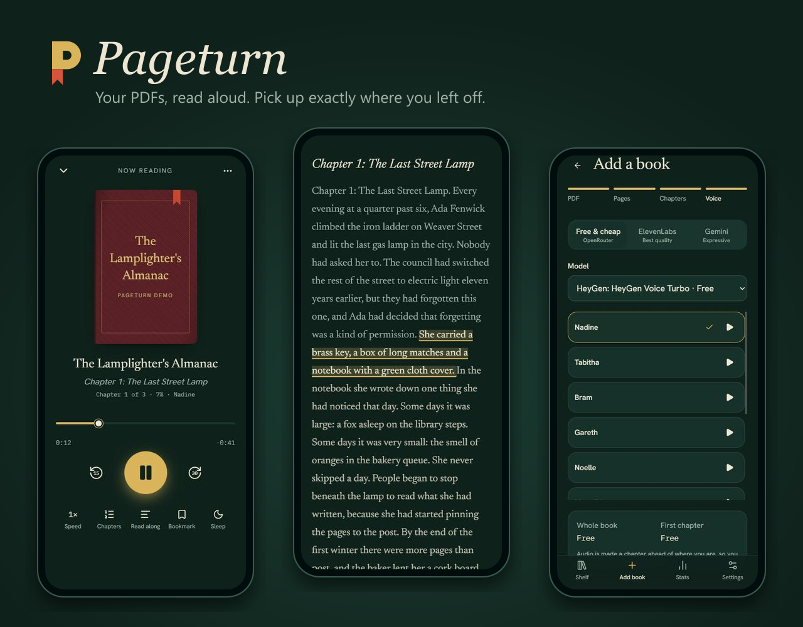
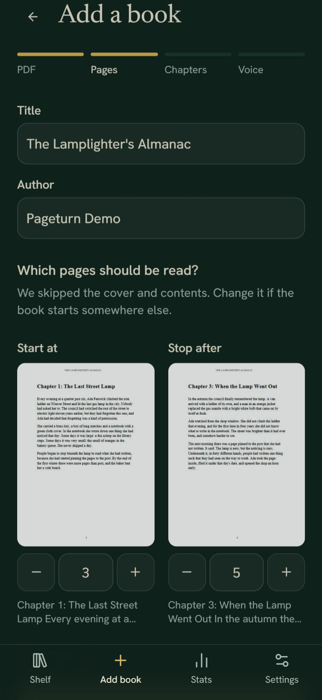
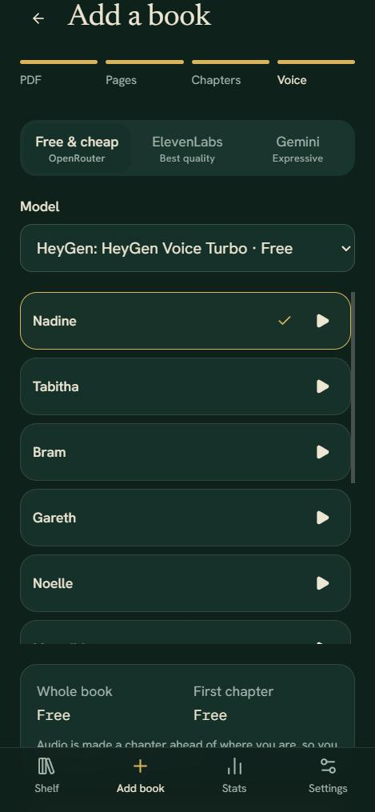
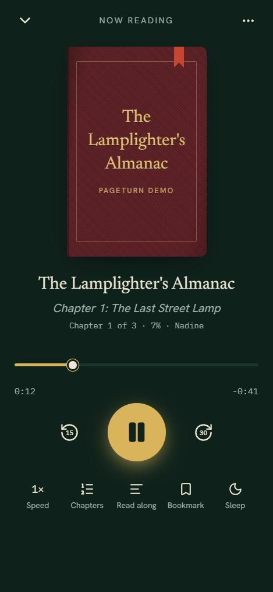
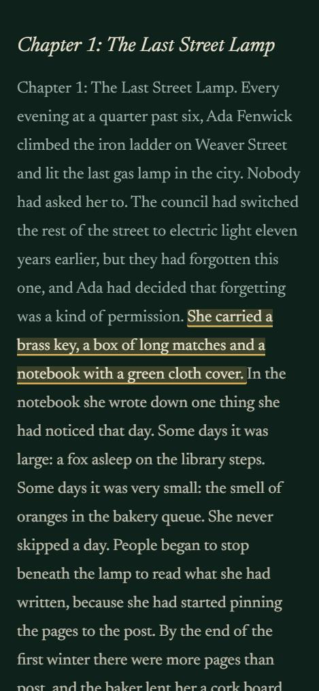
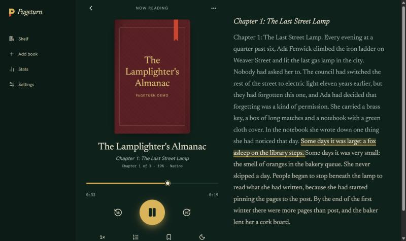
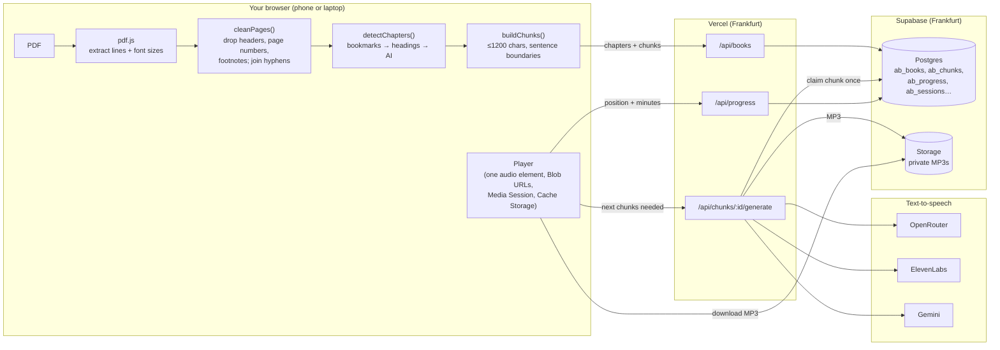
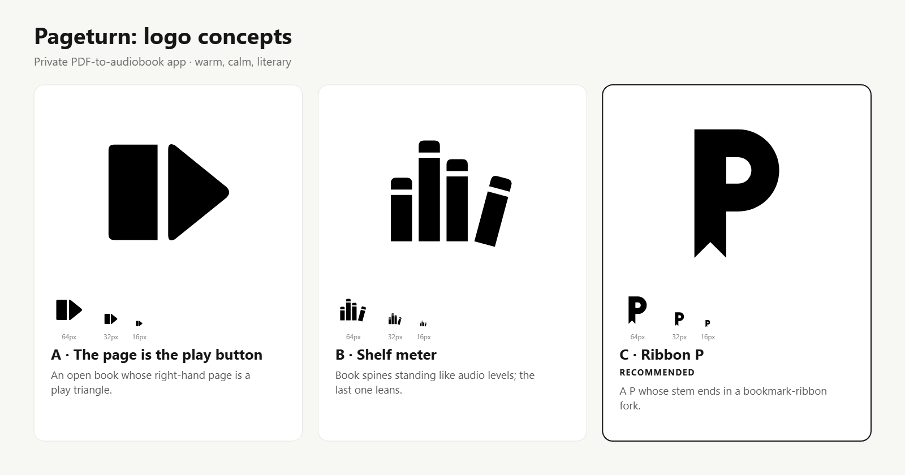

<div align="center">



# Pageturn

**Turn any PDF into an audiobook you can listen to on your phone, and pick up exactly where you left off.**

A private, installable web app: upload a PDF, choose where the book really starts, pick a voice, press play.
It reads the book aloud chapter by chapter, highlights the sentence it's speaking, remembers your place on every device,
and tracks your listening streak.

`Next.js 16` · `React 19` · `Supabase` · `Vercel` · `pdf.js` · `ElevenLabs` · `Gemini TTS` · `OpenRouter` · `PWA`

*A weekly build from the **Built & Broken** channel: one project, built in public, including everything that broke along the way.*

</div>

---

## Contents

- [Why I built it](#why-i-built-it)
- [What it does](#what-it-does)
- [How it works](#how-it-works)
- [What broke (and how it was fixed)](#what-broke-and-how-it-was-fixed)
- [Tech stack](#tech-stack)
- [Project structure](#project-structure)
- [Run it yourself](#run-it-yourself)
- [What it costs](#what-it-costs)
- [Design](#design)
- [Tests](#tests)
- [Limits and next steps](#limits-and-next-steps)

---

## Why I built it

I have more PDFs I want to read than time to sit and read them. Audiobook apps only play books that were *made* into
audiobooks. I wanted something that would take **my** PDFs and read them to me on a walk, at the gym, or in bed,
without paying for a whole book's worth of narration up front, and without losing my place when I switch from laptop to phone.

## What it does

| | | |
|:---:|:---:|:---:|
|  |  |  |
| **Add a PDF.** It's read on your device. The cover and contents are skipped automatically. | **Pick a voice.** Free, cheap and premium voices, each with a sample and a cost estimate. | **Listen.** Lock-screen controls, ±15/30 s, speed, sleep timer. |

| | |
|:---:|:---:|
|  |  |
| **Read along.** The spoken sentence is highlighted; tap any sentence to jump there. | **Desktop too.** Player and text side by side. |

**Everything in the box**

- 📄 **PDF import in the browser.** Text is extracted with pdf.js, running headers, page numbers and footnotes are removed, and words hyphenated across lines (and pages) are re-joined.
- 🧭 **Chapter detection.** It uses the PDF's own bookmarks first, then large headings like "Chapter 3". AI is the fallback, and if nothing works the book is split into even parts. You can rename or merge chapters.
- 🔍 **Scanned pages.** Pages with no text layer are read by a free vision model. Blank pages are detected on the device and skipped.
- 🗣️ **Three kinds of voices.** OpenRouter (free and near-free), ElevenLabs (best quality) and Gemini TTS. You can switch voices mid-book.
- 💸 **Pay for what you hear.** Audio is generated **one chapter ahead** of where you are, never the whole book at once. Paid voices ask before each new chapter, and ElevenLabs warns before a chapter would use more than 10% of your remaining credits.
- 🔁 **Resume anywhere.** Your position is saved every 10 seconds and when you close the app. Open it on another device and you're at the same sentence.
- 🔖 **Bookmarks with notes.** Saves the exact sentence you were hearing.
- ⏪ **"Previously on…"** If you've been away more than a day, you get a 20-second spoken recap of where you left off.
- 📶 **Offline chapters.** Download the next two chapters before a flight.
- 📊 **Stats.** Minutes per day, a 12-week heatmap, a daily goal, a streak and an evening reminder.
- 📱 **Installable.** Add it to your iPhone or Android home screen and it opens full screen, like a native app.
- 🔒 **Private.** Only allow-listed emails can log in. Every database row and audio file is locked to its owner.

## How it works



**The heavy work happens on your device.** Opening a 300-page PDF, cleaning it and splitting it into chapters all runs in the browser, so the server only ever handles small, quick jobs: "make the audio for this one chunk".

**A few pieces worth reading in the code:**

| Piece | File | What's interesting |
|---|---|---|
| Text cleanup | [`lib/pdf/clean.ts`](lib/pdf/clean.ts) | Finds running headers by spotting the same edge text on ≥30% of pages (ignoring digits), footnotes by size and position, and paragraph breaks from line spacing. |
| Chunking | [`lib/book/chunk.ts`](lib/book/chunk.ts) | Splits on sentence boundaries with `Intl.Segmenter`, never crosses a chapter, falls back to word boundaries for run-on text, and re-joins `remark-` + `able` across page breaks. |
| Generate exactly once | [`supabase/migrations/0001_audiobook.sql`](supabase/migrations/0001_audiobook.sql) → `ab_claim_chunk` | One atomic `UPDATE … RETURNING` claims a chunk. Two tabs or a double tap can never pay for the same audio twice. A claim that's stuck for 3 minutes can be retaken. |
| Generate-ahead + cost gate | [`lib/player/queue.ts`](lib/player/queue.ts) | Generates the rest of the current chapter, and starts the next one once half of this one is ready. Rules for when a paid voice has to ask first. |
| Voices | [`lib/tts/`](lib/tts) | One `TtsProvider` interface for three APIs. ElevenLabs returns per-character timings; Gemini returns raw PCM (encoded to MP3 with lamejs); HeyGen-on-OpenRouter only speaks PCM at 44.1 kHz. |
| Read-along timing | [`lib/tts/timings.ts`](lib/tts/timings.ts) | Uses exact character timestamps when the voice provides them, and spreads the audio duration by character count when it doesn't. |
| The player | [`lib/player/store.ts`](lib/player/store.ts) | A small external store (`useSyncExternalStore`) that owns one `<audio>` element for the whole app, so audio keeps playing while you browse. It unlocks audio inside the first tap (iOS), syncs your position with `sendBeacon` on close, and merges positions from two devices by "newest wins". |
| Offline | [`lib/offline/books.ts`](lib/offline/books.ts), [`public/sw.js`](public/sw.js) | Downloaded chapters live in Cache Storage with a JSON snapshot of the book, so the player can open without a network. |

## What broke (and how it was fixed)

The best part of building in public: here's what actually went wrong, each with the test that now guards it.

1. **"Media could not be screened" (422).** Free vision models reject a blank page image outright. **Fix:** measure the ink on each rendered page in the browser and skip blank pages before any AI call (`lib/pdf/ink.ts`, `tests/ink.test.ts`).
2. **The free voice wouldn't play.** HeyGen's free TTS on OpenRouter answers MP3 requests with *"only supports response_format pcm"*, and the PCM arrives at 44.1 kHz. **Fix:** retry with `pcm`, remember which models need it, read the rate from the `Content-Type` header, and encode to MP3 (`tests/openrouter-tts.test.ts`).
3. **"remark… able".** A word hyphenated across a *page* break was read as two words, because the cleanup only joined hyphens within a page. **Fix:** join across pages when building chunks (`tests/chunk.test.ts`: *joins a word hyphenated across a page break*).
4. **One bad scan stopped the whole import.** **Fix:** OCR failures now skip that page with a warning, and the import carries on.
5. **"Not started" after 30 seconds of listening.** Progress only counted whole chunks. **Fix:** include the time inside the current chunk (`tests/progress-math.test.ts`).
6. **Abandoned imports left PDFs in storage.** The upload started as soon as you picked a file. **Fix:** upload only when the book is created.
7. **Slow taps on the phone.** The app's server functions ran in Washington DC while the database lives in Frankfurt, so every query crossed the Atlantic, and every page checked the login with Supabase over the network up to three times. **Fix:** move the functions to `fra1`, verify the login token locally with its ES256 public key (`getClaims`) once per request, stream the slow part of the shelf, and show instant skeleton screens on every tab.

## Tech stack

| Layer | Choice | Why |
|---|---|---|
| App | **Next.js 16** (App Router, Turbopack) + **React 19** + TypeScript | Server routes for the short TTS jobs, client components for everything interactive |
| UI | **Tailwind 4**, **shadcn/ui** (Base UI), lucide icons | Accessible primitives, custom "bindery" theme |
| PDF | **pdf.js** (`pdfjs-dist`) in the browser | No upload size limits; the server never parses PDFs |
| Data + auth | **Supabase**: Postgres with Row Level Security, Storage, email + password auth | Every `ab_*` table and every storage path is locked to its owner |
| Voices | **OpenRouter** (free/cheap TTS + free text models), **ElevenLabs**, **Gemini TTS** | Free first, premium when it's worth it |
| Audio | `@breezystack/lamejs` | PCM → 64 kbps mono MP3 (~29 MB per hour of audio) |
| Hosting | **Vercel** (functions in Frankfurt), daily cron for the reminder | Same region as the database |
| Tests | **Vitest** (105 tests) | Pure logic plus a real-PDF pipeline test |

## Project structure

```text
app/
  (app)/            Shelf, import wizard, player (/book/[id]), stats, settings; loading skeletons
  api/              books, chunks/[id]/generate, voices, progress, ai/ocr, ai/chapters, recap, cron
  login/            Email + password login (allow-listed)
components/
  player/           Player screen, read-along, sheets (chapters, speed, sleep, bookmarks), mini player
  import/           Import wizard and page thumbnails
  voice/            Voice picker with samples and cost estimates
  stats/            Bar chart, 12-week heatmap, goal ring
lib/
  pdf/              Extraction, cleanup, rendering, blank-page detection
  book/             Chapters, chunking, start-page guess, progress maths, recap source
  tts/              Provider interface, ElevenLabs, Gemini, OpenRouter, timings, cost
  player/           Player store, generate-ahead queue, timeline, progress merge
  offline/          Offline chapter downloads
  supabase/         Browser/server clients, proxy session refresh
supabase/migrations/  Database schema, RLS policies, ab_claim_chunk(), storage bucket
brand/              Logo concepts, final mark, exported icon set
tests/              Unit tests + tests/fixtures/sample.pdf
```

## Run it yourself

**You need:** Node 20.9+, a Supabase project, and at least one voice key. A free [OpenRouter](https://openrouter.ai/keys) key is enough to start.

```bash
git clone <this repo> pageturn && cd pageturn
npm install                 # also copies the pdf.js worker into /public
cp .env.example .env.local  # then fill it in (see below)
```

1. **Database.** Run [`supabase/migrations/0001_audiobook.sql`](supabase/migrations/0001_audiobook.sql) in the Supabase SQL editor. It creates the `ab_*` tables, RLS policies, the claim function and a private `audiobooks` bucket.
2. **Your login.** In Supabase, go to **Authentication → Users → Add user**, enter your email and a password, and tick *Auto Confirm User*. Put the same email in `ALLOWED_EMAILS`.
3. **Run it:**
   ```bash
   npm run dev
   ```
   Open http://localhost:3000 and log in.

| Variable | Needed for |
|---|---|
| `NEXT_PUBLIC_SUPABASE_URL`, `NEXT_PUBLIC_SUPABASE_PUBLISHABLE_KEY` | Everything |
| `ALLOWED_EMAILS` | Who may log in (comma-separated) |
| `OPENROUTER_API_KEY` | Free/cheap voices, free AI for chapters, OCR and recaps |
| `ELEVENLABS_API_KEY` | ElevenLabs voices |
| `GEMINI_API_KEY` | Gemini voices and backup AI |
| `NEXT_PUBLIC_VAPID_PUBLIC_KEY`, `VAPID_PRIVATE_KEY`, `CRON_SECRET`, `SUPABASE_SECRET_KEY` | Optional: the daily reminder (`npx web-push generate-vapid-keys`) |

**Deploy:** import the repo in Vercel (framework: Next.js), add the same environment variables, and deploy. `vercel.json` already pins the functions to Frankfurt (`fra1`); change it to the region nearest your Supabase project.

## What it costs

Running the app is free on the Vercel Hobby and Supabase Free plans. The only real cost is the voice. For an average 80,000-word book (about 450k characters, or 9–10 hours of audio):

| Voice | Approximate cost for a whole book |
|---|---|
| OpenRouter free models (e.g. HeyGen Voice Turbo free) | **$0** (rate-limited) |
| Kokoro 82M via OpenRouter | **≈ $0.28** |
| Gemini 3.8 Flash TTS | ≈ $7 |
| ElevenLabs Flash | ≈ 225,000 credits |

Because audio is made a chapter ahead of where you are, you only pay for the chapters you actually listen to.

## Design

The look is a **bindery**: every book gets a generated cloth-bound cover (eight cloth colors, picked from the book's ID) with a gold-stamped title and a **red ribbon bookmark whose length shows your progress**. The app is dark by default, because you mostly listen at night with the screen locked. The fonts are Newsreader for book text, Hanken Grotesk for the interface and IBM Plex Mono for times.

The logo was designed with the [logo-design skill](https://github.com/kaankiziltug/logo-design-skill) process: a brief, three concepts tested at 16 px, then a full icon set.



The chosen mark, **Ribbon P**, is a P whose stem becomes the bookmark ribbon. It ships as a favicon, an Apple touch icon and an Android maskable icon (`brand/dist/`).

## Tests

```bash
npm test        # 105 tests: cleanup, chunking, chapters, timings, costs, MP3, queue, progress, streaks…
npm run lint
npm run build
```

`tests/pdf-pipeline.test.ts` runs a real PDF (`tests/fixtures/sample.pdf`, generated by `scripts/make-fixture.mjs`) through extraction, cleanup, chapter detection and chunking. The screenshots use an original demo book generated by `scripts/make-demo-book.mjs`.

## Limits and next steps

- Free OpenRouter models are rate-limited per day; for a long book, switch to Kokoro or add credit.
- The ElevenLabs credits are shared with my YouTube narration, so the app guards them.
- Ideas: EPUB support, a sleep fade-out, CarPlay-friendly chapter art, sharing a bookmark as an image.

---

<div align="center">
Built by <a href="https://github.com/dennis299">dennis299</a> with Claude Code · part of the Built &amp; Broken weekly builds
</div>
